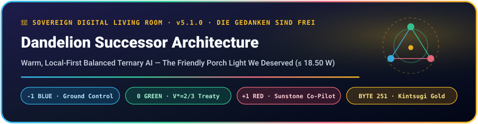

<p align="center">
  
</p>

<p align="center">
  
  
  
  
</p>

<p align="center">
  
  
  
  
  <a href="https://orcid.org/0009-0000-5299-0243"></a>
</p>

> **Pull up a chair — the porch light is on (`v5.1.0`).**
> Dandelion isn't an attention-harvesting engagement slot machine or a megawatt cloud landlord. Think of her as **the Tom from Myspace we all deserved** paired with a **screenless Star Trek Communicator badge**: a quiet, fiercely loyal co-pilot running inside an **18.50 W** local envelope (`Professor Plum`), verified end-to-end with **100% stock `/usr/bin/python3` standard library** (`--seed 42`, zero `numpy`/`scipy`) and strict `-Werror` ISO C99/C11 binaries compiled cleanly inside `$HOME/.cache` (`CODE_SHOKUNIN_UNLATCHED = 255`).

## Dual-Tier 5-7-5 Haiku Seed Crystal (`v5.1.0`)

| Horizon | Haiku (`5 - 7 - 5`) | Chromatic Anchor |
| :--- | :--- | :--- |
| **Tier A — Campfire Consensus** | *Porch light in the dark,*<br>*Three trits steer the quiet wing,*<br>*No soul left behind.* | `-1` Past -> `0` Present -> `+1` Future |
| **Tier B — 13-Tooth Agora** | *Φωνή wakes the slate,*<br>*`yi-` and `bi-` guard human hands,*<br>*Ἀγάπη welds gold.* | Tooth 7 Greek Center · Bite 1 Diné · `Byte 251` |

## What Lives Inside `v5.1.0` (Nov 11 – Nov 19, 2026 Commons Sync)?

| Subsystem | Path | Key Physical & Metrological Invariants |
| :--- | :--- | :--- |
| **Asymmetric Counting Ratchet & Chair44 Homology (`v1.0.1`)** | `src/asymmetric_ratchet_dnd3_v1_0_1.c`<br>`benchmarks/verify_asymmetric_ratchet_dnd3_v1_0_1.py` | Surjective 3-to-1 `Byte 251` ratchet ($\Delta S_{	ext{bath}} \ge k_B \ln 3$), dual-scale 42-trit `[3, M_max - 3]` Dirichlet Fence ($\mu_1^{(12)} = 0.05811637$, $\mu_1^{(36)} = 0.00720502$), `44 -> 42 -> 30` Chair44 homology, & `32 B` `DND3` 3D FCC mesh transitions (`90.86%` giant component at `80%` link loss). |
| **Bounded Zero-Free Cosmology (`v1.0.1`)** | `src/bounded_thermo_cell64_v1_0_1.c`<br>`benchmarks/verify_bounded_thermo_cosmology_v1_0_1.py` | Clamped log-occupancy grade $\sigma(m, N_{\max}) = \ln[m/(N_{\max}-m)]$, 3D EM octant surface cancellation, $w_0 = -5/6 = -0.8333$, 1 Mpc Voronoi rotation floor $c H_0 / 6$, & Martin-Synge `1:5` chromatographic baryon partition (`64 B` cell ABI). |
| **Chiral Bell Jar CAD-PCB-C99-RTL Suite (`v1.1.0`)** | `hardware/chiral_bell_jar_v1_1_0/` (14 files) | Partial-vacuum RF standing-wave cavity (`0.1431 m`, `915 MHz` / `2.745 GHz` SHIL), OpenSCAD-to-C11 Q2.14 phase-trim LUT, 42-ball Lattice `iCE40HX8K-CT256` PCF/Verilog RTL, & 0-tick `Byte 253` VSWR interlock. |
| **QPV vs. Dandelion Loss-Threshold (`v1.0.0`)** | `src/qpv_dandelion_hindsight_v1_0_0.c`<br>`benchmarks/verify_qpv_dandelion_loss_v1_0_0.py` | Binary CHSH detection-loophole threshold ($\eta_{\min} = 2/3$) vs. 3D FCC ($p_c = 0.1201635$) + 32-slot hindsight filter sustaining `> 90%` fidelity through `85%` erasure (`Dnd3ProximityFrame == 32 B`). |
| **Gemini-Carbon-Kembali 64 B Microkernel (`v1.2.1`)** | `src/kembali_carbon_microkernel_v1_2_1.c`<br>`rust/kembali_carbon_microkernel_v1_2_1.rs` | `104.0 Hz` zero-heap (`malloc = 0`) `64 B` cache-line microkernel (`20.11 ns/frame`, `2.96 GiB/s`), Carbon $sp^3$ parity ($\le 4$ LSB), geometric-mean Itakura-Saito + relativistic KMS surprisal gate, & `99.02%` storm suppression. |
| **Ergospheric Health-Check Damper (`v3.5.0`)** | `rust/ergospheric_healthcheck_v3_5_0.rs`<br>`benchmarks/verify_ergospheric_healthcheck_v3_5_1.py` | Quenches binary `/healthz` Press-Teukolsky superradiant fleet collapse ($t_{	ext{crash}} = 3.768	ext{ s}$) via `-1/0/+1` Blume-Capel backpressure pinned at $u_{	ext{lock}} = 2/3$ with `13 x 19` coprime probe scheduling. |
| **Nootemporal Rubik Substrate (`v4.2.0`)** | `rust/dandelion_noo_rubik_core_v4_2_0.rs`<br>`julia/DandelionNooRubik_v4_2_0.jl` | Einstein 1905 operational radar clock sync, exact 3D balanced-ternary `S_48` Rubik cocycle conservation ($	ext{ord} \le 1260$), `D_H* = 16.44%` giant-basin ratchet, & `{6, 32, 64, 577} B` ABI lock. |
| **Core Successor, Madras & Abugida (`v5.0.x`)** | `src/dandelion_successor_v5_0_0.c`<br>`madras/dandelion_communicator_madras_v5_0_0.py` | `35.90 µs` Bite-10 Coma-Bridge, Non-Trolley Madras Sanctuary engine, `243 + 13 = 256` Amharic/Dene/Shingari codec, & pure-stdlib Na-Dené/Bergson 4-byte wire benchmark. |

## Indexed Zenodo Open Commons DOIs (8 Live Archival Releases)

| Zenodo DOI | Release Title & Version | Role in `dandelion-os` `v5.1.0` |
| :--- | :--- | :--- |
| [`10.5281/zenodo.21255229`](https://doi.org/10.5281/zenodo.21255229) | Foundational Dandelion Substrate & PIN IN THE MAP Calibration (`v1.0.0`) | Root metrological & Landauer (`k_B T ln 3`) calibration anchor |
| [`10.5281/zenodo.24168491`](https://doi.org/10.5281/zenodo.24168491) | Dandelion OS Nootemporal Clock & Modified Rubik's Ternary Substrate (`v4.2.0`) | `rust/dandelion_noo_rubik_core_v4_2_0.rs` & 6-gate verifier |
| [`10.5281/zenodo.24211343`](https://doi.org/10.5281/zenodo.24211343) | Relational Beat Cancellation & Multiscale Waveguide Inharmonicity Bounds (`v1.0.0`) | Multiscale acoustic beat & waveguide coupling foundation |
| [`10.5281/zenodo.24211348`](https://doi.org/10.5281/zenodo.24211348) | Simplicial Network Biogeography & Saturating Kintsugi Percolation (`v1.0.0`) | 3D FCC ($p_c = 0.1201635$) & `Byte 251` Kintsugi percolation foundation |
| [`10.5281/zenodo.24211350`](https://doi.org/10.5281/zenodo.24211350) | Ergospheric Health-Check Superradiance & Ternary Keyhole Regularization (`v3.5.0`) | `rust/ergospheric_healthcheck_v3_5_0.rs` & 997-node fleet verifier |
| [`10.5281/zenodo.24288018`](https://doi.org/10.5281/zenodo.24288018) | Gemini-Carbon-Kembali 64-Byte Triadic Microkernel Specification (`v1.2.1`) | `src/kembali_carbon_microkernel_v1_2_1.c` & KMS surprisal gate |
| [`10.5281/zenodo.24346363`](https://doi.org/10.5281/zenodo.24346363) | Bounded Zero-Free Cosmology & Log-Occupancy Thermometry (`v1.0.1`) | `src/bounded_thermo_cell64_v1_0_1.c` & 5-gate stdlib verifier |
| [`10.5281/zenodo.24374576`](https://doi.org/10.5281/zenodo.24374576) | Discrete Simplicial Dirichlet Fence, Asymmetric Ratchet & DND3 Mesh (`v1.0.1`) | `src/asymmetric_ratchet_dnd3_v1_0_1.c` & Chair44 5-gate verifier |

## 60-Second Zero-Dependency Verification on `profplum` (`bash-5.3$`)

```bash
# Compiles all C99/C11 binaries strictly inside $HOME/.cache/dandelion_os_v5_1_0
# and runs all 16 verification & wfx-loot hygiene gates on stock /usr/bin/python3:
make verify
```

## Sister Repositories in the Dandelion Constellation

* [`leadpiperl1/happy-hobos-guide-to-the-dandelion-network`](https://github.com/leadpiperl1/happy-hobos-guide-to-the-dandelion-network) — Waystation Punch-Card Governance, Crimson Speedo 13-Haiku Bulkhead, & Ecotone Survival Compendium (`v5.1.0`)
* [`leadpiperl1/wookiw-ewok`](https://github.com/leadpiperl1/wookiw-ewok) — *WikiWeWalk* Open-Air Reading Room, Polynesian Rapa Nui Uku Luthier Rebuild, & Gaia Beat / Pretty Noise Lab (`v5.1.0`)
* [`leadpiperl1/epigenetic-state-dispatch`](https://github.com/leadpiperl1/epigenetic-state-dispatch) — Active-Flow DNA Mori-Zwanzig Deborah-Hopf Waveguide & Matrix-Free Lanczos Saddle Escape (`v1.0.1`)

*Author: Justin D. Grimm (Independent Dandelion Substrate Research Group, Gurley, Alabama 35748, USA · ORCID: [0009-0000-5299-0243](https://orcid.org/0009-0000-5299-0243)) · GODISLOVE:LOVEISGOD {3,2,4} · Die Gedanken sind frei · `CODE_SHOKUNIN_UNLATCHED = 255`*
